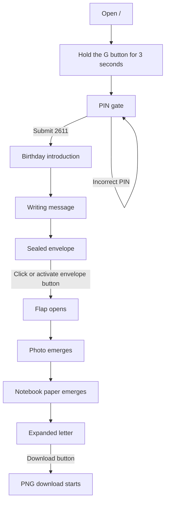

# G-birthday — Project Description

Reviewed on **24 November 2026**.

This document describes the current project from its source code, configuration, dependency lockfile, installed package metadata, and local image asset. The inspection was read-only; this document is the only file created. The application was not launched, built, or tested during this review, so descriptions of rendering and interaction represent the implementation in the code rather than a browser verification.

## 1. Purpose and current scope

**G-birthday** is a personalized Arabic birthday-surprise website. It guides its recipient through a deliberate opening interaction, a birthday-themed PIN gate, and a romantic reveal consisting of introductory messages, an envelope, a photograph, and a letter that can be downloaded as an image.

The interface addresses **غيداء** in its welcome text and letter. The letter is signed **Mijo ♡**. Its visual style combines pink gradients, flowers, hearts, gold text, translucent controls, a pastel envelope, and paper resembling a handwritten notebook page.

The project is a private npm package named `g-birthday`, version `1.0.0`. It uses Next.js App Router, React, TypeScript, Tailwind CSS, Framer Motion, and html2canvas.

There is **one application route: `/`**. Its different views are component states within that route. The URL does not change as the recipient progresses.

All personalized content and the PIN are defined in source files. The application includes no API routes, database integration, content management interface, user accounts, or application-level persistence. It also has no audio or video elements.

## 2. Project structure

```text
G-birthday/
├── src/
│   ├── app/
│   │   ├── layout.tsx             Document layout, metadata, and Amiri font
│   │   ├── page.tsx               Home route and three-step scene controller
│   │   └── globals.css            Tailwind import, font utility, global colors
│   └── components/
│       ├── HoldToUnlock.tsx       Three-second press-and-hold opening screen
│       ├── PasswordGate.tsx       Four-digit PIN keypad and success transition
│       └── GrandReveal.tsx        Timed messages, envelope, photo, letter, export
├── public/
│   └── her-photo.jpg              Photograph displayed inside the envelope
├── package.json                  Package information, scripts, dependencies
├── package-lock.json             Exact dependency resolution, lockfile version 3
├── tsconfig.json                 TypeScript and Next.js compiler configuration
├── postcss.config.mjs            Tailwind PostCSS plugin configuration
├── next-env.d.ts                 Generated Next.js TypeScript declarations
├── .gitignore                    Dependency, build, environment, and log exclusions
└── README.md                     Earlier setup and PIN-gate documentation
```

The workspace also contains `node_modules/`, `.next/`, and `tsconfig.tsbuildinfo`. These are installed dependencies, generated Next.js output, and TypeScript incremental metadata, respectively. Their presence does not establish that the current application passes a build or type check.

No custom `next.config.*`, additional routes, test files, test-runner configuration, lint script, or CI/deployment configuration was found in the inspected project files.

## 3. Architecture and navigation

[`src/app/layout.tsx`](src/app/layout.tsx) supplies the shared HTML document. It sets `lang="ar"` and `dir="rtl"`, loads global CSS, and configures an Amiri font variable.

[`src/app/page.tsx`](src/app/page.tsx) is a client component. Its `HomePage` stores an integer `step` in React state and renders the corresponding component:

| Step | Component | How it advances |
| --- | --- | --- |
| `0` | `HoldToUnlock` | A completed three-second hold triggers `onComplete`, setting step to `1`. |
| `1` | `PasswordGate` | A successful PIN submission triggers `onSuccess`, setting step to `2`. |
| `2` | `GrandReveal` | Internal phases reveal the final letter; no further top-level step exists. |



Each top-level scene sits inside a `motion.div`. `AnimatePresence` uses `mode="wait"`, allowing the departing scene to finish its exit before the next scene enters. The scene opacity transition lasts `0.6` seconds, or `0` when reduced motion is enabled. These durations are additional to animations inside the individual components.

Navigation is entirely local React state. There is no router navigation, back button, replay button, or storage of unlocked progress. Reloading the route initializes `step` to `0` again. The final letter remains the last view until the page is reloaded or left.

The root layout is the only authored component without a `"use client"` directive. The home page and all three interactive components explicitly use client-side React behavior. There is no application data-fetching layer.

## 4. View 1: Press and hold to begin

Source: [`src/components/HoldToUnlock.tsx`](src/components/HoldToUnlock.tsx).

### Appearance

The first screen is a centered, full-width section with a minimum height of `100svh`. It contains a decorative `✦ ♡ ✦` ornament, a gold Arabic heading, a large circular **G** button, a surrounding progress ring, an instruction, and changing status text.

The background is a five-stop rose/pink gradient with soft white radial highlights. Eighteen flower emoji elements use `🌸`, `🌺`, `🌷`, and `💮`. Their positions, sizes, drift, rotation, and timing are derived deterministically from their indices. During normal motion, they fall from above the viewport to below it while drifting and rotating. Flower cycles range from `14` to `24` seconds; the background gradient moves on a `24`-second cycle.

The button has a translucent pink radial gradient, rounded borders, blur behind it, inset highlights, two decorative flowers, and an italic serif **G** in gold. Its outer container is `16rem × 16rem`, increasing to `18rem × 18rem` at the `sm` breakpoint. The interactive button is inset by `11%` within that container.

An SVG ring has a pale static track and a gold-to-rose progress stroke. A white halo grows more opaque as progress increases. The button scales to `0.95` while holding when reduced motion is off.

### Visible text

| UI element/state | Current text |
| --- | --- |
| Heading | `لمسة منك سكرة و تبدأ الحكاية 🌸` |
| Instruction | `اضغطي مطولًا لمدة ٣ ثوانٍ` |
| Idle status | `لحظة صغيرة… وحكاية لكِ وحدكِ` |
| Holding status | `خليك ضاغطة ... قربنا ♡` |
| Completed status | `وبلمستكِ… بدأت الحكاية ♡` |

### Interaction

The hold duration is exactly **3,000 milliseconds** in the code. A primary pointer press, or holding Space/Enter while the button is focused, starts a new hold from zero. Timing uses `performance.now()` and Framer Motion's animation-frame callback. The same elapsed time determines the ring progress and whether the hold completes.

Releasing before the deadline cancels the attempt, and the ring returns to zero over `0.35` seconds. Every new attempt requires the full three seconds, even if that reset animation has not finished. A release at or after the deadline still completes the hold if the next animation frame has been delayed.

Pointer handling captures the active pointer and checks the circular button boundary when it moves. Leaving the button before completion ends the attempt. Pointer cancellation, lost pointer capture, button blur, window blur, switching the document to a hidden state, or pressing Escape cancels an active hold. The component ignores secondary pointers and non-primary mouse buttons. Keyboard repeat events do not start duplicate holds.

When the hold completes, the button is disabled, the content fades, and a white overlay covers the screen. Normally this overlay takes `0.95` seconds after a `0.1`-second delay. With reduced motion, it takes `0.18` seconds without a delay. Only after the overlay animation completes does the component notify its parent to show the PIN gate.

The ring exposes a progressbar role and percentage values, updated in `10%` steps for accessibility; the visual stroke updates every animation frame.

## 5. View 2: Birthday PIN gate

Source: [`src/components/PasswordGate.tsx`](src/components/PasswordGate.tsx).

### Appearance

The PIN screen repeats the opening screen's animated rose gradient, radial highlights, eighteen falling flowers, and small ornament. Its layout has a header, central keypad card, and footer. The card has a maximum width of `24rem`, a translucent white background, a white border, rounded corners, a soft pink shadow, and strong backdrop blur.

The header is gold and uses Amiri Arabic typography. The card floats gently by `7px` over a six-second repeating cycle during normal motion. Floating, error shaking, and success fading use separate animation wrappers.

Four rounded boxes show the input length. Empty boxes contain outlined hearts `♡`; filled boxes contain solid hearts `♥`. **The entered digits are not displayed.** The boxes and keypad explicitly use left-to-right direction inside the surrounding right-to-left page.

The keypad is a three-column grid:

| Left | Center | Right |
| --- | --- | --- |
| `1` | `2` | `3` |
| `4` | `5` | `6` |
| `7` | `8` | `9` |
| `Clear` | `0` | `Enter` |

Numeric and Clear buttons are translucent; Enter is a solid rose button. Buttons are `3.5rem` tall, with rounded corners, focus rings, hover styling, and optional spring-based press/hover motion. Enter appears disabled until exactly four digits have been entered.

### Visible text

| UI element/state | Current text |
| --- | --- |
| Heading | `مرحبا بفتاة الميلاد` |
| Welcome subtitle | `دي حاجة صغيرة من جمالك و جمال روحك يا أحلى غيداء بالكون` |
| Card title | `مفتاح المفاجأة` |
| PIN hint | `أربعة أرقام… ممكن تجربي تاريخ ميلادك يا سكر امكن يفتح 😂❤️` |
| Incorrect PIN | `القمر ما عارف تاريخ ميلاده ولا شنو؟ ♡` |
| Successful PIN | `كل عام وأنتِ أجمل أقداري ♡` |
| Card closing text | `كل ده سكر عشانك لحالك لبى اللي يبسط قلبي` |
| Footer | `أنتِ أجمل أسباب الفرح ♡` |

### Input and validation

The accepted PIN is **`2611`**, defined by `CORRECT_PIN` in the component. The input is capped at four characters. It does not auto-submit upon entry of the fourth digit; the user must submit using Enter on the keypad or the appropriate keyboard action.

| Input | Behavior |
| --- | --- |
| Click/tap a digit | Append it if fewer than four digits are present. |
| Keyboard `0`–`9` within the form | Append an ASCII digit. Arabic-Indic numerals are not handled by the keyboard digit regex. |
| `Clear` button | Clear the entire PIN and error. |
| Backspace | Remove the last digit and clear the error. |
| Escape or Delete | Clear all digits and the error. |
| Enter while the form itself is focused | Submit if the PIN contains four digits. |
| Enter/Space on a focused button | Preserve that button's normal activation behavior. |

Keyboard handling is scoped to the form and ignores modified/composing events. Tab navigation uses native form/button focus behavior.

An incorrect four-digit submission clears the PIN, shows the error, and shakes the card horizontally for `0.48` seconds during normal motion. A new digit or clear action removes the error. No attempt limit, lockout, or server validation is implemented.

A correct submission locks further input, disables the keypad, fades the content, and displays a white success overlay. The normal overlay duration is `1.15` seconds after a `0.15`-second delay; reduced motion uses `0.18` seconds without a delay. The parent advances only after that overlay completes. Ref guards prevent repeated completion callbacks.

This PIN is a birthday interaction implemented in browser code. It does not provide server-side authentication or access control for the letter or the publicly served photograph.

## 6. View 3: Grand reveal and its internal UIs

Source: [`src/components/GrandReveal.tsx`](src/components/GrandReveal.tsx).

The final component has seven phases: `anticipation`, `writing`, `envelope`, `opening`, `photo`, `paper`, and `letter`.

### Shared visual setting

This view switches to a cream background (`#fff8f3`) with overlapping pale pink, ivory, and beige radial gradients. Text is predominantly warm brown, rose, or gold. Five outlined hearts are positioned around the background. During normal motion they drift vertically by `14px` and gently vary their opacity.

Amiri is applied to the reveal section. Aref Ruqaa is applied to the photograph caption and notebook paper, giving them a handwritten Arabic appearance.

### Introductory and writing phases

The first phase displays the ornament `── ♡ ──` above:

> خلاص انتهت الحركات يا سكر و حيبدأ الأحتفال

The text uses a responsive gold font size of `clamp(1.8rem, 5vw, 3rem)`, generous line height, balanced wrapping, and a soft glow. The component's initial text is visible at mount without its own entrance delay because this `AnimatePresence` sets `initial={false}`; the outer home-page scene still has its own transition.

After a `3,000`-millisecond timer, the component enters the writing phase, displaying:

> خليك ثانية بس الرسالة بتتكتب حبي

Three small gold dots pulse and move beneath the text during normal motion. Once the writing text's entrance animation finishes, a `5,000`-millisecond timer begins before moving to the envelope.

These messages are staged presentation. The code does not generate a letter, call a writing service, or type text progressively. The actual letter is already defined as a constant.

Normal text entry/exit fades last `0.65` seconds. The three- and five-second timers therefore do not describe the entire wall-clock transition sequence. Timer cleanup and phase checks prevent stale timers from advancing unrelated phases.

### Sealed envelope

A pastel pink envelope appears in the center. Its width is `min(82vw, 23rem)` and its aspect ratio is `3 / 2`. It is drawn entirely with HTML/CSS layers: a back, front, left fold, right fold, bottom fold, and flap. Polygon clipping, gradients, borders, shadows, and `perspective: 1200px` give it its shape and depth.

The sealed envelope gently floats and scales during normal motion. Its round pink wax seal contains a pale heart and pulses every `2.6` seconds. An overlaid native button covers the envelope, displaying:

> أفتحي يا سكر

The button receives focus after the envelope entrance completes. It supports native click/tap and keyboard activation. The user must activate it to continue; the envelope does not open automatically. After activation the button is disabled and fades out.

### Opening and photograph

Activating the envelope changes its phase to `opening`. The flap rotates through `-180°` around its top edge over `0.85` seconds during normal motion. Its z-index changes halfway through the flip so that subsequent contents can appear above it.

Once the flap animation finishes, the photo phase begins. A white Polaroid-style card rises from the envelope, enlarges, and tilts by `-7°`. The photo extraction lasts `1` second. The caption reads:

> حبيبتي ♡

The image source is **`/her-photo.jpg`**, served from `public/her-photo.jpg`. This is an existing photograph, despite the component comment describing it as a placeholder. The inspected JPEG is **960 × 1280 pixels**, **334,004 bytes**. It renders through a normal HTML ``, with declared width/height `240 × 280`, eager loading, asynchronous decoding, and `object-fit: cover` inside a `6 / 7` frame. It does not use Next.js's `Image` component or image optimization pipeline.

The image alt text is `صورتك الجميلة`. If loading fails, a pink gradient frame containing `♡` replaces it and has the accessible label `حبيبتي`.

After the photograph's appearance animation completes, a **650-millisecond** timer starts. The photo then shifts to one side, becomes slightly smaller, and tilts further while the paper emerges.

### Paper extraction and expanded letter

A compact notebook page rises from the envelope over `1` second during normal motion. Its preview omits the signature and is hidden from assistive technology. When extraction finishes, the phase changes to `letter`.

The envelope and photo exit, and the full notebook page expands to a maximum width of `40rem`. The compact and full paper share a Framer Motion `layoutId`, allowing the preview to visually transition into the larger letter. Normal expansion takes `1` second.

The `NotebookPaper` helper component supplies both versions. The full paper resembles a cream notebook sheet with:

- A warm off-white background (`#fffdf2`) and fine simulated grain.
- Repeated pale blue ruled lines at `36px` intervals.
- A red margin line physically positioned on the left, even though the text is RTL.
- Three decorative punched holes along that left margin.
- Slightly irregular corner radii, a thin border, and soft surrounding shadows.
- Right-aligned Aref Ruqaa text, with `clamp(1.25rem, 3.4vw, 1.6rem)` sizing.
- Preserved line breaks and wrapping for a longer message if the source constant is changed.

The current full letter contains exactly:

| Part | Current content |
| --- | --- |
| Salutation | `إلى بهجة أيامي ♡` |
| Message (`loveLetter`) | `الى أجمل غيداء بالكون` |
| Signature | `Mijo ♡` |

The message is currently one short sentence. The code supports multiline content through `white-space: pre-wrap`, but a longer letter is not present in this version.

After expansion completes, `letterReady` is set, the paper receives programmatic focus, and a gold rounded download button appears below it. The layout reserves at least `100px` for the button so its appearance does not move the paper.

## 7. Letter download

The download button captures **only the notebook paper**, including its salutation, message, signature, ruled background, margin, and decorative paper details. The photo, envelope, surrounding background, and download button are outside the captured element.

| State | Visible text |
| --- | --- |
| Ready | `لو ضغطتي هنا تقدري تحملي الرسالة بالمناسبة ... مش قلت ليك جبت أخري في الموقع ده؟` |
| Saving | `لحظة يا حبي… بنجهز الرسالة` |
| Download triggered | `بدأ تحميل الرسالة ♡` |
| Export error | `حصلت مشكلة في التحميل، جربي تاني يا حبي.` |

When activated, `downloadLetter()`:

1. Checks that the letter is ready and prevents concurrent exports with a ref lock.
2. Sets the saving state and dynamically imports `html2canvas`, loading it only when needed.
3. Waits for `document.fonts.ready` so the Arabic fonts are available for capture.
4. Measures the paper using the larger of its offset and scroll dimensions.
5. Chooses a rendering scale capped at `2`, with calculations intended to keep each canvas dimension at or below `8,192px` and the canvas area at or below `16,000,000` pixels.
6. Renders the paper with `backgroundColor: null`, explicit dimensions, `useCORS: true`, and logging disabled.
7. Adjusts the cloned DOM to remove focus outlines and the paper's outer shadow, expose overflow, and remove transforms, animations, transitions, and inherited animation opacity from the paper and its ancestors.
8. Converts the canvas to a PNG Blob, creates a temporary object URL and hidden anchor, and triggers its download.
9. Removes the anchor and revokes the object URL after `30` seconds.

The requested filename is **`رسالة-الميلاد❤️.png`**. This is an image export; the project does not create a PDF or text document. Its dimensions reflect the paper's current rendered layout and the selected canvas scale, so there is no fixed export resolution.

The button is disabled and marked busy while saving. If capture fails, an error is displayed and another attempt is possible. The success status indicates that the browser download was triggered; it does not confirm that the user saved the file. Export processing occurs in the browser, with no application upload endpoint.

## 8. Design system, typography, and responsive behavior

### Colors and styling

The styling combines Tailwind utilities, inline CSS values, Framer Motion animation props, and a global styled-jsx block inside `GrandReveal.tsx`.

| Area | Main styling |
| --- | --- |
| First two screens | Rose/pink gradients, translucent white controls, rose text, gold headings, flower emoji |
| Final reveal | Cream and blush radial gradients, warm brown text, outlined hearts |
| Envelope | Layered pale pink folds, pink wax seal, CSS perspective and flap rotation |
| Notebook | Cream paper, blue ruled lines, red margin, brown handwriting, paper grain |
| Download button | Gold gradient, rounded pill shape, light text, gold glow |
| Global defaults | Light color scheme, body background `#fff1f2`, body text `#881337` |
| Text selection | Background `#fda4af`, text `#881337` |
| Favicon | Gold heart on a rounded pale pink square, encoded as an SVG data URL |

There is no theme switcher or authored dark theme. Most decorations are CSS, inline SVG, or emoji; no separate icon library is imported. The photograph is the sole file in `public/`.

### Fonts

| Font | Configuration and use |
| --- | --- |
| Amiri | Loaded with Arabic/Latin subsets, weights `400` and `700`, and `display: "swap"`. The layout exposes `--font-amiri`; Tailwind maps `font-arabic` to it. The reveal also defines an Amiri font class for its section. |
| Aref Ruqaa | Loaded with Arabic/Latin subsets, weight `400`, and `display: "swap"`; used for the notebook and photo caption. |
| Arial / Helvetica / sans-serif | Global body fallback; elements without an overriding font utility/class inherit it. |
| Serif / Georgia | The large G uses Tailwind's serif utility; the wax-seal heart specifies Georgia. |

Amiri and Aref Ruqaa are loaded through Next.js's built-in `next/font/google`, not standalone npm font packages. Font acquisition can require network access during a build; Next.js handles the resulting font assets.

### Responsive layout

Interactive sections use a minimum height of `100svh`; the home page and scene wrappers also use Tailwind's `min-h-screen`. Content is centered using flex or grid layouts, with flexible widths and horizontal padding.

The project uses Tailwind's `sm` and `md` responsive variants without custom breakpoint overrides. These correspond to its default `40rem` and `48rem` breakpoints. Padding, heading sizes, circle size, and some button text sizes increase on larger screens. Responsive `clamp()` values keep the opening heading, reveal messages, and letter text fluid.

The final reveal has generous vertical padding and can grow beyond a single viewport. The notebook can expand for longer text; it has no fixed reading-height limit or separate scrollable reading panel. A custom `@media (max-width: 420px)` rule reduces paper padding and adjusts the physical-left margin and holes for narrow screens.

Pointer events support both mouse and touch. The hold button uses `touch-none`, pointer capture, and suppression of dragging/context menus. The keypad uses `touch-manipulation`. These are implementation provisions for touch interaction; device-specific appearance and behavior were not tested in this review.

## 9. Accessibility and reduced motion

The implementation includes Arabic language declarations and RTL direction, native buttons and a native PIN form, descriptive labels, visible focus rings/outlines, and live status messages.

Decorative flowers, hearts, background layers, envelope folds, and compact paper are hidden from assistive technology. The PIN announces only the number of entered digits, rather than the digits themselves. The full notebook exposes an article role and an Arabic label, and has `tabIndex={-1}` for programmatic focus. The photograph has alt text and an accessible failure fallback.

The initial hold button and PIN form attempt to receive focus on mount only when the active element is the document body. The envelope button receives focus after its entrance, and the full paper receives focus after expansion. The PIN keypad contains some English labels, including `Clear PIN`, `Enter PIN`, and `PIN keypad`.

Framer Motion's `useReducedMotion()` reads the user's preference. In the first two screens, a local reduced-motion state starts as `true` on both server and initial client render, then synchronizes with the device preference. This keeps their initial decorative rendering still and consistent.

With reduced motion, the implementation stops falling flowers and animated gradient movement, removes the keypad float and error shake, suppresses most hover/tap transforms, and shortens or removes many transitions. The final reveal's decorative hearts and writing dots become still, and its primary transition durations become zero.

The three-second hold requirement, introduction timer, writing timer, and photo pause still apply. The hold ring still conveys progress, and a canceled hold still uses its `0.35`-second reset. Photo position/rotation variants still change, but their principal transition durations become zero. Reduced motion therefore does not skip the content sequence or remove every visual state change.

No accessibility audit, screen-reader session, contrast measurement, or browser interaction test was performed for this document.

## 10. Libraries and tools

The tables below include **all direct dependencies** in `package.json`. Declared ranges come from that file; resolved versions come from `package-lock.json`. Installed package metadata matched these resolved versions during inspection.

### Application dependencies

| Package | Declared range | Resolved/installed version | Role in this project |
| --- | --- | --- | --- |
| `next` | `^16.0.0` | `16.4.5` | App Router, document layout, metadata, font loading, development server, production build/server, TypeScript integration |
| `react` | `^19.2.0` | `19.3.1` | Components, state, effects, refs, callbacks, generated IDs, and event handling |
| `react-dom` | `^19.2.0` | `19.3.1` | Browser rendering/hydration through Next.js; not directly imported by application components |
| `framer-motion` | `^12.0.0` | `12.43.0` | Scene transitions, presence handling, motion values, SVG progress, animation frames, shaking, 3D flap movement, and shared paper layouts |
| `html2canvas` | `^1.4.1` | `1.4.1` | On-demand DOM-to-canvas capture of the letter for PNG download |

The Framer Motion APIs imported by the source include `motion`, `AnimatePresence`, `animate`, `useAnimationControls`, `useAnimationFrame`, `useMotionValue`, `useMotionValueEvent`, `useTransform`, and `useReducedMotion`, plus the `Variants` type.

### Development dependencies

| Package | Declared range | Resolved/installed version | Role |
| --- | --- | --- | --- |
| `typescript` | `^5.9.0` | `5.9.3` | Type checking and TS/TSX language support |
| `tailwindcss` | `^4.1.0` | `4.3.5` | Utility classes, responsive variants, and the Arabic font theme utility |
| `@tailwindcss/postcss` | `^4.1.0` | `4.3.5` | Tailwind integration with PostCSS in Next.js's stylesheet processing |
| `@types/node` | `^22.0.0` | `22.20.5` | Node.js type declarations |
| `@types/react` | `^19.0.0` | `19.3.0` | React component, hook, ref, and event types |
| `@types/react-dom` | `^19.0.0` | `19.3.0` | React DOM type declarations |

### Framework features and relevant transitive packages

`next/font/google` and Next.js's `Metadata` type are features of `next`, not additional dependencies. `<style jsx global>` uses Next.js's styled-jsx support. Standard browser APIs provide pointer capture, timers, font readiness, canvas PNG conversion, Blobs, object URLs, and anchor downloads.

Relevant supporting packages resolved in the lockfile include:

| Package | Resolved version | Relationship |
| --- | --- | --- |
| `motion-dom` | `12.43.0` | Framer Motion's DOM animation implementation |
| `motion-utils` | `12.39.0` | Motion utility functions |
| `styled-jsx` | `5.1.6` | Next.js's embedded JSX styling support |
| `postcss` | `8.5.32` | Stylesheet processing dependency used by the build toolchain |
| `@tailwindcss/node` | `4.3.5` | Tailwind's Node.js build integration |
| `@tailwindcss/oxide` | `4.3.5` | Tailwind's scanning infrastructure |
| `@next/swc-win32-x64-msvc` | `16.4.5` | A platform-specific Next.js compiler package recorded in the lockfile |

These are supporting dependencies rather than direct application imports. The lockfile records **114 package entries excluding the root package**, including platform-specific and optional entries; that count does not mean all packages run in the browser. `package-lock.json` contains the complete transitive inventory.

## 11. Configuration and available commands

`package.json` declares a Node.js requirement of **`>=20.9.0`**. The locally inspected Node.js executable was **`v24.18.0`**. The project uses npm and has a version-3 npm lockfile.

| Command | Defined script | Purpose |
| --- | --- | --- |
| `npm run dev` | `next dev` | Run the development server |
| `npm run build` | `next build` | Create a production build |
| `npm run start` | `next start` | Serve an existing production build |
| `npm run typecheck` | `tsc --noEmit` | Check TypeScript without emitting application JS |

The README documents installing dependencies with `npm install` and accessing the app at `http://localhost:3000`. The scripts do not specify a custom port. Installation requires access to the package registry; a fresh build may also need access for the Google fonts.

`tsconfig.json` enables strict type checking, bundler-style module resolution, isolated modules, React JSX, incremental compilation, and the Next.js TypeScript plugin. It targets `ES2017`, includes DOM and modern ECMAScript libraries, and defines the path alias **`@/*` → `./src/*`**. It includes generated Next.js route types and excludes `node_modules`.

`postcss.config.mjs` registers `@tailwindcss/postcss`. `globals.css` imports Tailwind with `@import "tailwindcss"` and maps `--font-arabic` to the Amiri variable with `@theme inline`.

`next-env.d.ts` references Next.js and image types and imports generated development route/root-parameter declarations from `.next/dev/types/`. It is explicitly marked as generated and not to be edited.

`.gitignore` excludes dependency/build output, TypeScript incremental files, logs, and `.env*` files, with an exception for `.env.example`. No environment file or application environment-variable usage was found in the inspected project.

No install, development-server, type-check, or build command was run for this review. In particular, TypeScript incremental mode can update `tsconfig.tsbuildinfo` even with `--noEmit`, and Next.js commands can update generated files; those commands were left unexecuted to preserve the existing project files.

## 12. Document metadata and personalization locations

The shared layout declares:

| Metadata | Current value |
| --- | --- |
| Page title | `إلى أحلى فتاة ميلاد ♡` |
| Description | `مفاجأة صغيرة، وحبّ كبير لا ينتهي.` |
| Document language | `ar` |
| Document direction | `rtl` |

The favicon is created in `page.tsx` from an inline SVG data URL. The component renders a `<link rel="icon">`; the source notes React 19's handling of that link in the document head.

Personalization is located directly in these files:

| Content or behavior | Source location |
| --- | --- |
| Page title, description, document settings | `src/app/layout.tsx` |
| Favicon and top-level scene transitions | `src/app/page.tsx` |
| Opening heading, G button, hold instructions, three-second requirement | `src/components/HoldToUnlock.tsx` |
| Accepted PIN, welcome text, hints, error/success text | `src/components/PasswordGate.tsx` |
| Introductory messages, phase timings, photo caption, letter text/signature, download text/filename | `src/components/GrandReveal.tsx` |
| Photograph | `public/her-photo.jpg` |
| Global color/font defaults | `src/app/globals.css` |
| Envelope, notebook, and download-button CSS | Global styled-jsx block in `GrandReveal.tsx` |

These are descriptions of the current configuration points; no personalization or source edits were performed.

## 13. Accuracy notes about the existing README

The existing README remains useful for basic setup and many PIN-gate interactions, but it describes an earlier application state:

- It lists the PIN gate and a welcome screen, whereas the current home route begins with `HoldToUnlock` and ends with the complete `GrandReveal` sequence.
- It instructs the reader to replace the welcome screen with birthday content; the current code already contains the envelope, photo, notebook letter, and PNG export.
- Its font overview mentions Amiri but omits the current Aref Ruqaa font.
- Its library overview omits the current html2canvas exporter.
- Its statement about the initial files having been written without running checks is historical and does not establish the current verification status.

This description follows the current source and installed/locked dependency metadata. Browser rendering, exact device compatibility, build success, type-check success, and PNG output fidelity remain unverified by this review.
